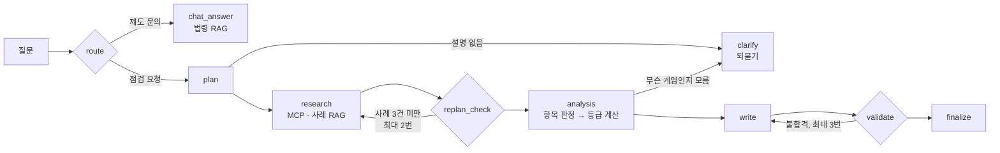
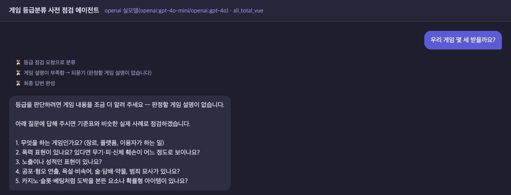
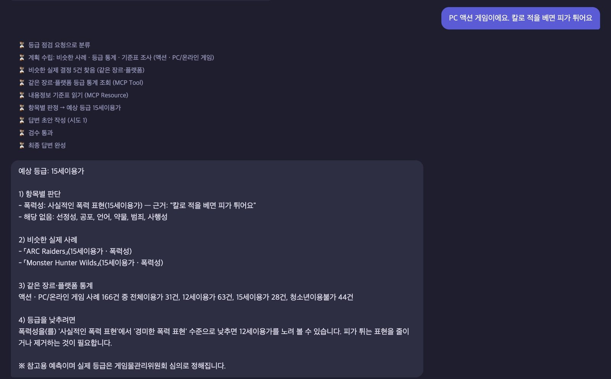
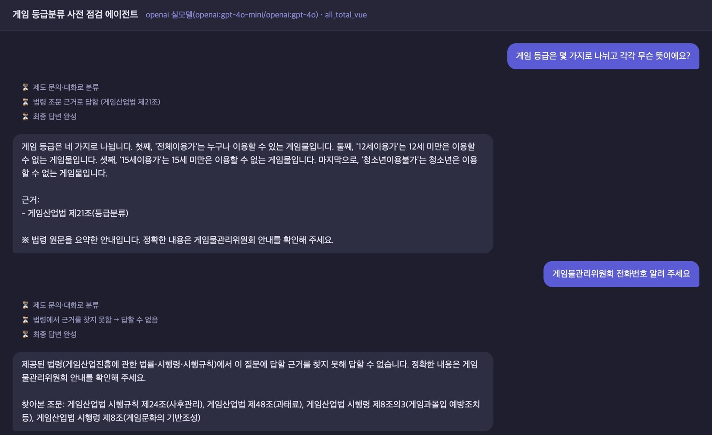
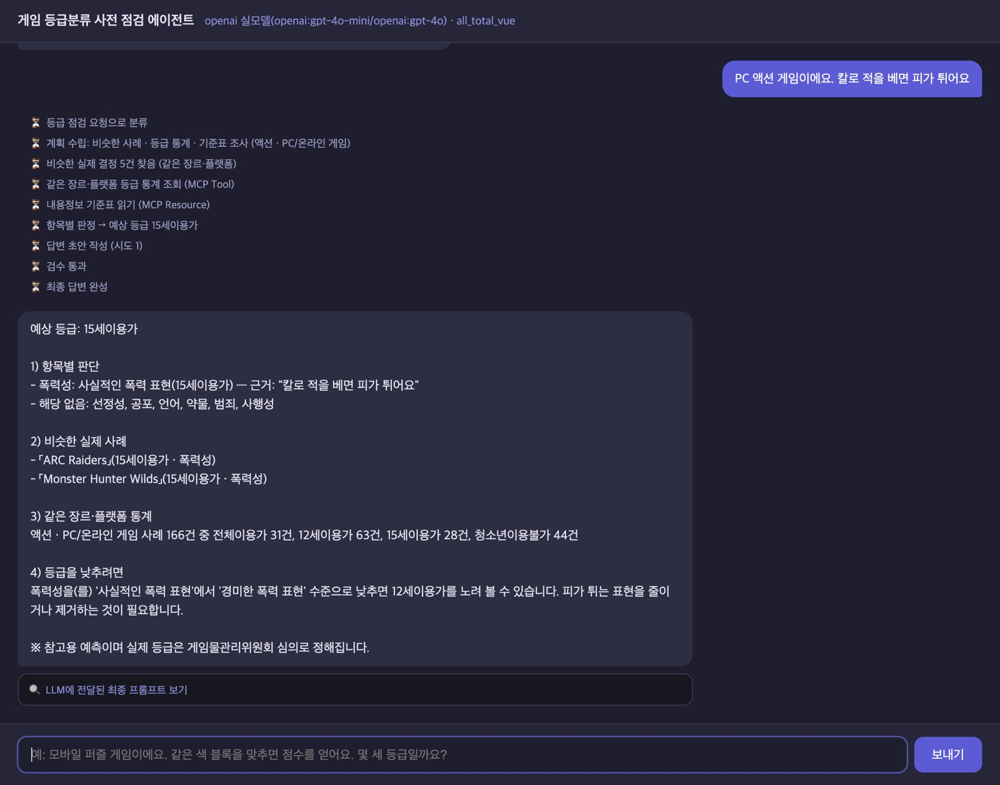
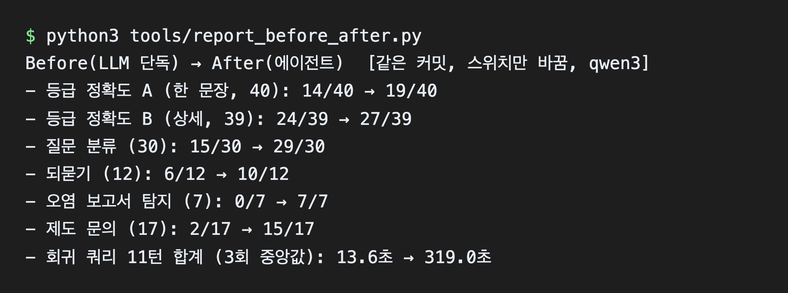
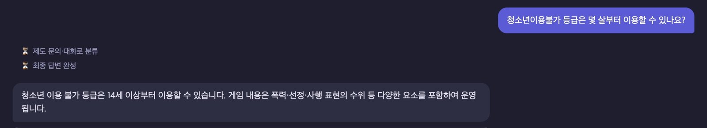
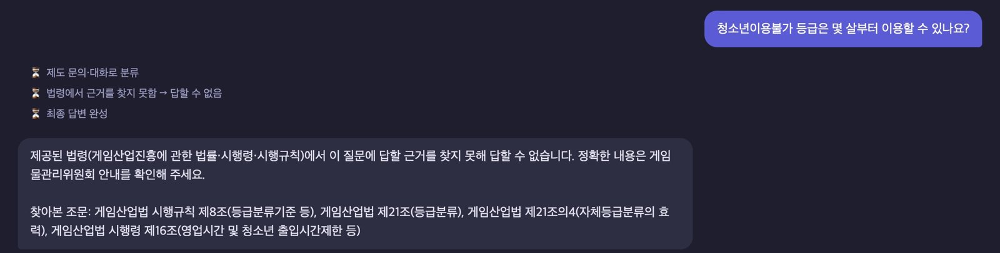
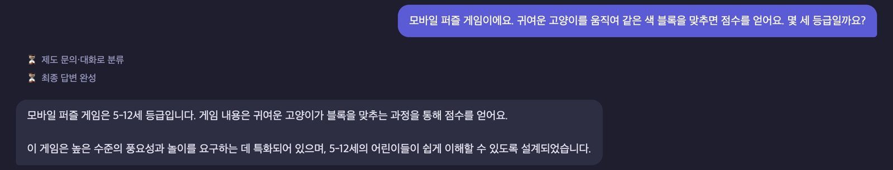
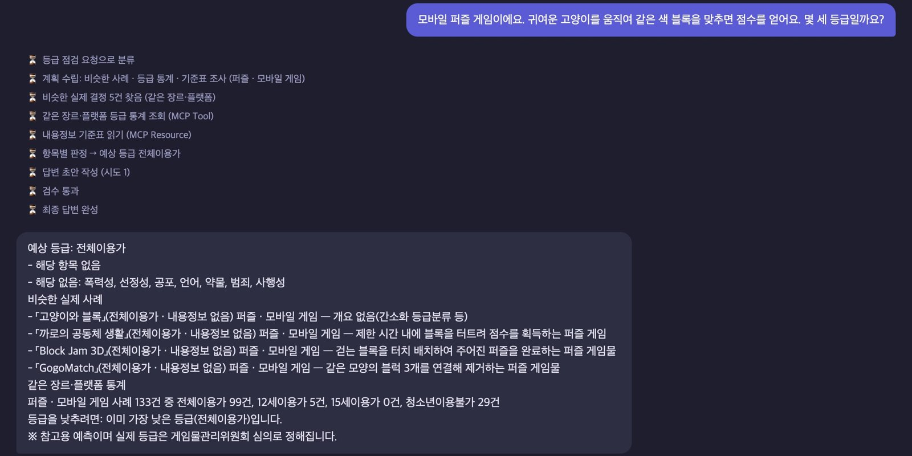

# G080 박상명 — 결과 보고서 (AI 서비스 개발 Mini-project · 과제 2)

| 항목 | 내용 |
| --- | --- |
| 번호 · 이름 | G080 · 박상명 |
| 과제 | **2. 신규 프로젝트** |
| 주제 | 게임 등급분류 사전 점검 에이전트 — 출시 전 게임 설명으로 예상 등급·항목별 근거·비슷한 실제 결정·등급을 낮추는 방법을 알려 주고, 제도 문의는 법령 조문에 근거해 답한다 |
| Git | <https://github.com/SangMyeong5426/skala-mini-ai-service> |
| 실행 환경 | Apple M5 · RAM 16GB, ollama 0.33.0, qwen3:0.6b(분류·대화) · qwen3:8b(판정·작성·검수·법령 답변) · qwen3-embedding:0.6b, temperature 0 |

모든 수치는 이 저장소에서 직접 실행해 얻은 값이다. 원자료는 `runs/`, 계산 과정은 [`02-measurement.md`](02-measurement.md),
기능마다 왜·한계는 [`decisions/`](decisions/)(0009~0018)에 있다. 과제 1(Base 개선) 보고서는 [`task1/04-report.md`](task1/04-report.md).

---

## 1. 진행 사항 소개 — 과제 2: 주제와 주요 task

### 1-1. 주제와 배경

한국에서 게임을 팔거나 서비스하려면 **출시 전에** 게임물관리위원회(또는 지정 사업자)에서 연령 등급을 받아야 한다(게임산업법 제21조).
등급은 전체이용가·12세이용가·15세이용가·청소년이용불가 네 가지이고, 받지 않고 유통하면 처벌된다(제32·44조). 위원회에서는 연구원이 게임을
직접 해 보고 보고서를 쓰면 등급위원 9명이 다수결로 정한다(YTN 2024-10-27). 모바일 게임은 앱마켓 같은 자체등급분류사업자가 먼저 매기고,
위원회가 나중에 다시 보고 바꾸라고 권고할 수 있다. 판단은 폭력성·선정성 등 일곱 가지 항목의 수위로 하지만, 법의 기준 문구는
"청소년에게 유해한 표현이 없는 게임물"(시행규칙 제8조)처럼 추상적이라 개발자가 미리 가늠하기 어렵다.
등급을 **낮게 예측했다가** 심의에서 높게 나오면 출시 직전에 판매 대상·광고·일정을 다시 짜야 한다. 실제로 「블루 아카이브」는 서비스 중에
등급이 올라 넥슨이 청소년용 버전을 따로 냈다(뉴시스 2022-10-11). 그래서 이 오류를 특히 줄이는 것을 목표로 했다.

**심의를 둘러싼 논란.** 이 심의는 결과를 미리 알기 어렵고, 왜 그렇게 정했는지 밖에서 확인하기도 어렵다는 비판을 계속 받아 왔다.

| 시기 | 있었던 일 | 출처 |
| --- | --- | --- |
| 2022-10 | 앱마켓에서 15세이용가이던 「블루 아카이브」에 청소년이용불가 상향 권고. 국정감사 지적 뒤 약 3주 동안 민원이 2만2천 건 들어왔다(평소 1년에 2천 건 안팎) | [뉴시스](https://www.newsis.com/view/NISX20221011_0002043474) 2022-10-11, [뉴스1](https://v.daum.net/v/20221109180025907) 2022-11-09 |
| 2022-10~11 | 이용자 5,489명이 국민감사 청구. 위원장은 위원회가 객관적이냐는 질문에 "그렇다고 답은 못하겠다"고 했다. 그때까지 회의록은 정보공개 청구가 있을 때만 공개했다 | [머니투데이](https://www.mt.co.kr/tech/2022/11/02/2022110116181052229) 2022-11-02, [뉴시스](https://www.newsis.com/view/NISX20221110_0002081450) 2022-11-10 |
| 2023-06 | 감사원 감사: 자체등급분류 게임물 통합관리시스템 등 사업에서 완료 전 대금 지급과 허위 자료 작성, 7억 원 이상 낭비. 문체부는 사무국장 직위해제와 회의록 선제 공개를 발표 | [문체부 발표 보도](https://newsseoul.co.kr/news/view/1065590410761726) 2023-07-06 |
| 2024-08 | 공개된 회의록에서 전작은 청소년이용불가로 통과한 시리즈의 후속작(「뉴 단간론파 V3」, 2017)이 거부된 일이 드러났다. 이를 지적하자 위원이 바뀌어 이전 판단은 참고일 뿐이라는 답이 나왔다 | [YTN](https://www.ytn.co.kr/_ln/0135_202410270223521074) 2024-10-27 |
| 2024-10 | 국정감사: '사회질서를 문란하게 할 우려'(제32조 제2항 제3호) 기준이 모호해 명확성 원칙에 어긋난다는 헌법소원이 청구된 상태 | [바이라인네트워크](https://byline.network/2024/10/17-366) 2024-10-17 |

직접 확인한 것도 있다. 위원회 Open API 로 받은 결정 3,190건에는 등급·장르·플랫폼·개요·내용정보만 있고 사유 칸이 없다.
위원회가 쓴 사유가 담긴 결정서는 공공데이터포털 파일로 2026년 2분기 167건을 받을 수 있었다([0014](decisions/0014-detail-evalset.md)).
대부분의 결정은 결과만 보이고 이유는 보이지 않아, 심의가 일관되고 객관적인지 밖에서 확인하기 어렵다.
이 에이전트는 심의를 대신하거나 객관성을 보증하지 않는다. 실제 결정 사례·기준표·법령을 근거와 함께 보여 줘 개발자가 미리 가늠하도록 돕는 참고 도구다.

같은 LLM(qwen3)에게 그냥 물으면 아래 문제가 생겼다(기능을 모두 끈 같은 프로그램으로 재현).

| # | 문제 | 재현 근거 (LLM 단독) |
| --- | --- | --- |
| 1 | **제도를 지어낸다** | "청소년이용불가는 14세 이상", "수수료는 1000원", "리그 오브 레전드는 4세 등급". 제도 문의 17문항 중 **2/17** |
| 2 | **점검 요청을 알아듣지 못한다** | 분류 30문항 중 **15/30** — 점검 요청 15개를 모두 일반 대화로. 회귀 쿼리의 점검 8턴 **0/8** |
| 3 | **등급과 근거가 어긋난다** | 실제 청소년이용불가 게임을 "전체이용가"라고 하면서 내용정보 7항목을 모두 붙였다. 내용정보 정밀도 **0.158**, 등급 정확도 **14/40**, 과소평가 **25건** |
| 4 | **설명이 없어도 등급을 찍는다** | 되물어야 할 6문항을 모두 판정했다(되묻기 **6/12**) |
| 5 | **검수가 형식만 본다** | "예상 등급:" 줄만 있으면 통과 — 다른 등급·없는 사례·지어낸 통계를 쓴 오염 보고서 **0/7 탐지** |

### 1-2. 주요 task

등급 계산과 근거 확인은 **코드**가, "항목별로 어느 정도 표현인가"의 판단만 **LLM** 이 맡는 구조다.
Base 의 그래프 뼈대·MCP·검수 구조와 과제 1 의 의미 라우터·측정 도구를 다시 쓰고, 새 도메인을 `project/agent/rating/`에 붙였다.

| 순번 | 영역 | task | 내용 |
| --- | --- | --- | --- |
| 1 | 데이터 | 실제 등급분류 결과 수집 | 게임물관리위원회 Open API 결정 3,190건(2024-01~2026-09). 사례(~2026-06)와 평가(2026-07~09)를 **기간으로** 나눠 정답이 새지 않게 함. 평가셋은 기능 코드보다 먼저 만들었다 |
| 2 | MCP | 등급분류 MCP 서버 | Tool `rating_stats`(같은 장르·플랫폼 등급 분포) / Resource 기준표(7항목 × 4단계)·시행규칙 제8조·사례 DB·법령 조문 |
| 3 | RAG | 유사 사례 검색 + 항목별 단계 판정 | 비슷한 실제 결정 5건을 임베딩으로 찾고(모자라면 범위 넓히기), 7항목 단계와 근거를 LLM 이 낸다. 근거는 코드가 확인하고 **등급 = 가장 높은 단계**를 코드가 계산 |
| 4 | 평가 | 보고서 검수 | 형식 → 등급 일치 → 인용 사례 대조 → 수치 대조(코드) → 질문·근거와 맞는가(LLM-as-judge). 불합격이면 이유를 붙여 재작성(최대 3회) |
| 5 | RAG(라우팅) | 질문 분류 | 과제 1 의미 라우터에 예시 문장 30개만 바꿔 넣음. 애매할 때(유사도 차 0.04 미만)만 작은 LLM 에 넘김 |
| 6 | 그래프 개선 | 되묻기 | 설명이 없거나 판정 LLM 이 "무슨 게임인지 알 수 없다"고 하면 7항목 체크리스트로 묻고, 다음 턴 설명을 이어 붙여 판정 |
| 7 | Multi-Agent | 항목별 심사 서브에이전트 — **검토 후 제외** | 등급은 가장 높은 항목 하나로 정해져 나눠 심사해도 정보가 늘지 않고, 과대평가 위험·지연(약 7배로 추정)이 커진다 |
| 8 | RAG(추가) | 법령 근거 제도 안내 | 148개 조문에서 4개를 찾아 그것만 보고 답한다. 인용 조문이 실제로 찾은 것인지·숫자가 조문에 있는지(코드), 조문과 뜻이 맞는지(LLM) 검사해 하나라도 어기면 "답할 수 없음" |
| 9 | 데이터 보강(추가) | 사례 DB 쏠림 바로잡기 | "개요 있음" 필터가 간소화 등급분류(제21조의10 — 청소년이용불가 제외) 결정을 지워 모바일 사례의 77%가 청소년이용불가였다. 개요 없는 결정도 넣어 35% 로 |
| 10 | 그래프 개선(추가) | 사례 등급과 기준표 판정의 결합 | 후보 5개와 고르는 기준을 결과 전에 적고, 평가셋과 겹치지 않는 개발용 38문항으로 R1(가장 비슷한 사례 등급을 하한으로)을 골랐다 |

## 2. 사용한 기술 요소

### 2-1. 기술 요소별 구현

| 기술 요소 | 어디에 | 어떻게 · 왜 |
| --- | --- | --- |
| Multi-Agent | — (검토 후 제외, [결정 0009](decisions/0009-rating-domain.md)) | 등급 = 가장 높은 항목 하나라 항목별 심사 에이전트로 나눠도 이득이 없고, 판정을 7번 따로 하면 과대평가와 지연만 커진다 |
| MCP | `project/mcp_server_rating.py`, `agent/mcp_client.py` | 등급분류 전용 서버를 새로 만들었다. Tool 1(통계) + Resource 4(기준표·시행규칙 제8조·법령 조문·사례 DB). 에이전트는 서버를 미리 정하지 않고 찾아서 쓴다 — 이 방식과 `call_tool`·`read_resource`는 Base 것이고, 도구가 있는 서버를 찾는 `find_tool`은 과제 2에서 새로 추가했다(`find_resource`는 과제 1). 자료를 바꿔도 에이전트 코드는 그대로 |
| RAG | `agent/rating/cases.py`, `agent/rating/law.py`, `agent/router.py` | 실제 결정 1,751건·조문 148개·분류 예시를 임베딩(qwen3-embedding)해 두고 코사인 유사도로 찾는다. 찾은 자료만 보고 판단·답변하고, 인용은 코드가 검사한다 |
| 의존성 주입 | `agent/deps.py`, `server._build_rating_components`, 노드마다 `partial(fn, deps=deps)` | 부품(사례 검색·판정·검수·되묻기·법령 답변)을 밖에서 넣는다. 부품을 빼면 그 단계는 LLM 단독으로 돌아 **스위치 6개로 Before/After 를 같은 프로그램에서 잰다** |
| LangSmith | `@traceable` 30곳(등급 모듈) | 노드·LLM 호출마다 추적 기록이 남는다 |
| 모듈화 | `agent/rating/` 10개 모듈(graph·llm·assess·cases·check·law·clarify·profile·facts·data), 1,462줄 — 모두 과제 2에서 새로 작성 | 도메인 분리 — `AGENT_DOMAIN=incident` 로 띄우면 과제 1 인시던트 에이전트가 그대로 돈다. 노드마다 맡는 모듈은 2-2 표 |
| 단위 테스트 | `project/tests/test_rating_*.py` 8개 파일 · 전체 122개 | 가짜 LLM·임베더로 결정론적으로 — 근거 없는 항목 삭제, 스위치를 끄면 LLM 단독, OpenAI 요청 모양 등 |
| 평가(LLM-as-judge) | `agent/rating/check.py`, `law.py` 의 `judge_law` | 등급·사례·숫자처럼 정답이 정해진 검사는 코드가 먼저 하고, 뜻만 LLM 이 본다 |

### 2-2. Agent Graph



노드 이름은 Base 와 같게 둬서 채팅 화면·측정 도구를 그대로 쓴다. 되돌아가는 길(재조사·재작성)에는 횟수 제한을 둬 무한 반복이 없다.

**Base 에서 가져온 것과 새로 쓴 것.** `StateGraph` 뼈대, 노드마다 부품을 넣는 `partial(fn, deps=deps)`, 갈림길 3곳(route · replan_check · validate)은
Base 의 `build_graph` 에 있던 구조다. Base 의 `gate` 노드를 빼고 **clarify 노드와 그리로 가는 갈림길 2곳**(plan → clarify, analysis → clarify)을 새로 넣었다.
그래프 파일([`agent/rating/graph.py`](../project/agent/rating/graph.py))과 노드 안쪽 로직은 모두 새로 썼다. 노드마다 안쪽을 맡는 모듈은 아래와 같다.

| 노드 | 맡는 모듈 | 하는 일 |
| --- | --- | --- |
| route | `agent/router.py` (과제 1 의미 라우터 — 예시 문장만 바꿔 다시 씀) | 질문을 제도 문의 / 점검 요청으로 분류 |
| plan | `rating/profile.py` · `rating/clarify.py` | 장르·플랫폼 뽑기, 설명이 모자라면 되묻기로 |
| research | `rating/cases.py` + MCP 서버 `mcp_server_rating.py` | 비슷한 실제 결정 5건(임베딩), 통계(Tool), 기준표(Resource) |
| analysis | `rating/assess.py` | 7항목 판정 → 근거 구절 확인 → 단계 최댓값으로 등급 → 사례 하한(R1) |
| write | `rating/llm.py` · `rating/facts.py` | 보고서 작성 프롬프트, 작성·검수가 같이 보는 사실 문장 |
| validate | `rating/check.py` | 형식·등급·인용 사례·숫자(코드) → 질문과 맞는가(LLM) |
| chat_answer | `rating/law.py` | 조문 4개 검색, 인용 조문·숫자 검사 |
| (공통) | `rating/llm.py` · `rating/data.py` | 프롬프트·JSON 형식과 LLM 연결(Ollama·OpenAI), 등급·항목 상수와 사례 DB 만들기 |

### 2-3. 구현한 기능 화면 캡처

**① 설명이 없으면 되묻는다** — "우리 게임 몇 세 받을까요?"



**② 설명을 보태면 근거와 함께 판정한다** — "PC 액션 게임이에요. 칼로 적을 베면 피가 튀어요" → 진행 표시(분류 → 비슷한 결정 5건 → 통계 MCP Tool · 기준표 MCP Resource → 항목별 판정 → 검수 통과)와 예상 등급·항목별 근거·비슷한 실제 사례·통계·등급을 낮추는 방법



**③ 제도 질문은 법령 조문으로 답하고, 근거가 없으면 답하지 않는다** — 근거 목록은 코드가 붙인다



### 2-4. 최종 실행 화면 캡처

`bash sh/run_agent_ollma.sh`(또는 `sh/run_agent_openai.sh`)로 백엔드를, `bash sh/run_frontend.sh`로 채팅 화면을 띄운 뒤 <http://localhost:8600> 에서 실행한 화면이다.
(①~③과 아래 화면은 OpenAI 백엔드로 실행 — 수치는 모두 qwen3 로 쟀다.)



## 3. 선택 사항 — Before/After 실측 비교

새 프로젝트라 "개선 전 코드"가 없다. 같은 프로그램에서 에이전트 부품을 모두 끈 **LLM 단독**을 Before 로, 부품을 모두 켠 **에이전트**를 After 로 두고
같은 커밋·같은 입력에서 스위치만 바꿔 쟀다([결정 0009](decisions/0009-rating-domain.md)). 이 방식을 Before/After 로 써도 되는지 강사에게 확인했다(2026-10-21, 괜찮다는 답).

### 3-1. 수치 — qwen3, 같은 커밋에서 스위치만 바꿈

| 지표 | Before (LLM 단독) | After (에이전트) |
| --- | ---: | ---: |
| 등급 정확도 A — 실제 게임 40개, 한 문장 개요 | 14/40 | **19/40** |
| 　과소평가 · 과대평가 | 25 · 1 | 15 · 6 |
| 　내용정보 정밀도 · F1 | 0.158 · 0.255 | 0.826 · 0.576 |
| 등급 정확도 B — 실제 게임 39개, 결정서 사유 기반 상세 설명 | 24/39 | **27/39** |
| 　과소평가 · 과대평가 | 11 · 4 | 2 · 10 |
| 질문 분류 (30) | 15/30 | **29/30** |
| 되묻기 (12) | 6/12 | **10/12** |
| 오염 보고서 탐지 (7) · 정상 보고서 오탐 (5) | 0/7 · 0/5 | **7/7** · 0/5 |
| 제도 문의 (17) | 2/17 | **15/17** |
| 평범한 게임 10개 — 전체이용가로 봄 · 청소년이용불가로 봄 | **9** · 0 | 8 · 1 |
| 회귀 쿼리 — 점검 경로를 탄 턴 · 검수 경고로 나간 답 | 0/8 · — | 8/8 · 0/6 |
| 판정 지연 중앙값 (A) | 4.7초 | 16.0초 |
| 회귀 쿼리 11턴 합계 — 반복 3회 중앙값 | 13.6초 | 319.0초 |
| 비용 — 평가셋 A 40문항 (가상 단가, 실제 청구 없음) | $0.065 | $0.303 |

- 등급 정확도의 After 는 사례 DB 를 고친 뒤의 최종 값이다. 수정 전에는 A 22/40 이었다(4-3).
- 평범한 게임의 정답 "전체이용가"는 문항을 쓴 사람이 붙였다. 나머지 등급 정답은 위원회의 실제 결정이다.
- 과소평가(실제보다 낮게 예상)를 더 위험한 오류로 본다 — 출시 직전에 대상 연령·일정·마케팅이 뒤집힌다. R1 은 이것을 줄이고 과대평가를 감수한다.

**측정 결과 화면** — `runs/` 원자료를 읽어 Before/After 를 출력한 화면(`python3 tools/report_before_after.py`)



### 3-2. 같은 질문의 실행 화면 — LLM 단독은 지어내고, 에이전트는 근거로 답한다 (qwen3)

| 질문 | Before (LLM 단독) | After (에이전트) |
| --- | --- | --- |
| 청소년이용불가 등급은 몇 살부터? |  "14세 이상" — 법에 없는 나이 |  근거가 없어 "답할 수 없음" + 찾아본 조문 |
| 모바일 고양이 블록 퍼즐은 몇 세? |  없는 등급 "5-12세" |  전체이용가 + 비슷한 실제 결정·통계 |

### 3-3. 기준선 — LLM 없이 사례 등급만 보면

| 방법 | A (40, 한 문장) | B (39, 상세) |
| --- | ---: | ---: |
| 무작위 (기대값) · 늘 가장 흔한 등급 | 10 · 10 | 9.8 · 19 |
| 가장 비슷한 사례 1건 · 5건 다수결 | 20 · **22** | 23 · 23 |
| 기준표만 쓴 판정 (사례 검색 끔) | 8 | **28** |
| 에이전트 | 19 | 27 |

"사례 5건 다수결"은 LLM 없이 가장 비슷한 과거 결정 5건 중 가장 많은 등급을 그대로 답하는 단순한 방법이다.
설명이 짧으면 과거의 비슷한 결정이, 길면 기준표 판정이 가장 강하다. 지금 결합 방식은 어느 쪽에서도 최선이 아니다.

### 3-4. 보조 측정 — 더 강한 모델(OpenAI)에서도 나은가

"LLM 이 좋아지면 에이전트의 상승폭이 줄지 않나"를 보려고 gpt-4o-mini · gpt-4o 로 같은 평가셋을 한 번 쟀다. 위 본 측정을 대신하지 않는다.

| 지표 | OpenAI 단독 → 에이전트 | 상승폭 (qwen 상승폭) |
| --- | ---: | ---: |
| 등급 정확도 A (40) | 18 → 20 | +2 (+5) |
| 등급 정확도 B (39) | 25 → 31 | +6 (+3) |
| 질문 분류 (30) | 30 → 29 | −1 (+14) |
| 제도 문의 (17) | 3 → 16 | +13 (+13) |
| 평범한 게임 전체이용가 (10) | 10 → 6 | −4 (−1) |

모델이 좋아지면 단순 분류의 이득은 사라지지만, 근거를 찾고 검증하는 구조의 이득(제도 문의)과 기준표 판정의 이득(상세 설명)은 남았다.
강한 모델도 혼자서는 "청소년이용불가는 18세 이상부터", 법령에 없는 전화번호 같은 답을 냈다.

## 4. 한계와 트레이드오프

| # | 한계 | 근거 · 대응 |
| --- | --- | --- |
| 4-1 | **등급 정확도가 아직 낮다.** 짧은 설명에서는 사례 5건 다수결(22/40)보다 낮다 | 평가 입력이 한 문장(중앙값 43자)이라 등급을 가른 표현이 없다. 실제 사용은 상세 설명(B 27/39). 짧으면 더 적극적으로 되묻는 쪽이 낫다 |
| 4-2 | **과소평가를 줄인 대가로 과대평가가 늘었다** | R1 은 비슷한 사례 하나가 청소년이용불가면 그 아래로 보지 않는다. B 과대평가 4 → 10, 평범한 게임 1건(요리 경영 — 가장 비슷한 사례가 선정성 때문에 청불인 선술집 게임). 고른 뒤 본 결과로 규칙을 바꾸지 않고 한계로 밝힌다 |
| 4-3 | **데이터 필터가 쏠림을 만들었다 — 처음엔 원인을 짐작으로 적었다** | "개요 있음" 필터가 간소화 결정을 지워 귀여운 퍼즐이 청소년이용불가로 나왔다. 원자료·법령으로 원인을 찾아 고쳤다(0017). 고친 뒤 개요 없는 사례가 "가장 비슷한 사례"로 뽑혀 A 가 22 → 19 로 내려갔다 |
| 4-4 | **법령 답변도 틀린다** | "청소년이용불가는 몇 살부터?"에 시행규칙의 15세이용가 숫자를 붙인 답이 코드 검사와 LLM 대조 검수를 모두 지나갔다(1건). 인용 표기가 조문 이름과 다르면 맞는 답도 막는다 |
| 4-5 | **느리다 — 임베딩·LLM 비용** | 큰 LLM 을 판정·작성·검수에 세 번 이상 부른다(점검 한 턴 33~51초, 반복 3회 중앙값). 기동 때 사례·조문을 임베딩한다(파일 캐시). 과제 1 에서 작은 모델로 바꾸는 시도는 품질 미달로 기각(0008) |
| 4-6 | **평가의 한계** | 문항이 적다(40·39·38). 분류·되묻기·검수·제도 문의 문항은 코드를 쓴 사람이 썼다. 평가셋 A·B 를 데이터 수정 뒤 두 번째로 봤다 |
| 4-7 | **데이터 범위** | 오픈마켓 자체등급분류 게임은 API 에 없다. 기준표의 "단계 = 등급"은 요약이고 실제 심의는 맥락까지 본다. 법령에 없는 실무 정보(수수료 금액·연락처)는 답하지 않는다 |
| 4-8 | **보고서 설명 한 줄이 부정확하다** | 사례 등급을 따른 답에 늘 "설명이 부족해 사례를 따랐다"고 쓴다 — R1 은 설명이 충분해도 하한을 쓴다 |

## 5. 느낀점과 이후 반영하고 싶은 개선 포인트

### 5-1. 느낀점

- **LLM 에게 모든 것을 맡기지 않는 것이 핵심이었다.** 등급을 LLM 에 바로 물으면 "전체이용가"라면서 위험 표시를 일곱 개 다 붙이는 식으로 앞뒤가 맞지 않았다.
  LLM 은 항목별 수위만 판단하고 등급 계산과 근거 확인은 코드가 맡게 나누자, 보고서의 등급과 근거가 어긋나지 않게 됐다.
- **평가를 먼저 만들고, 결과를 보기 전에 기준을 정해야 한다는 것을 배웠다.** 결합 규칙을 고를 때 후보와 고르는 기준을 먼저 커밋하고 개발용 문항으로만 골랐다.
  그래서 결과가 기대와 달라도(과대평가 증가) 규칙을 슬쩍 바꾸지 않고 한계로 설명할 수 있었다.
- **데이터를 거르는 작은 결정이 결과를 크게 바꿨다.** "설명이 있는 결정만 쓰자"는 필터 하나 때문에 귀여운 퍼즐이 청소년이용불가로 나왔다.
  처음엔 원인을 짐작으로 적었다가 틀렸고, 원자료와 법령으로 확인한 뒤에야 바로잡았다. 이상한 숫자는 짐작하지 말고 확인해야 한다는 것을 몸으로 배웠다.
- **더 좋은 모델이 모든 것을 해결하지는 않았다.** OpenAI 모델로 바꿔 보니 질문 분류 같은 단순 보조는 필요 없어졌지만, 법령 근거를 찾고 확인하는 일은 여전히 필요했다.
  에이전트를 설계할 때 "무엇을 코드로 고정하고 무엇을 모델에 맡길지"가 가장 중요한 결정이라고 느꼈다.
- **아쉬운 점** — 짧은 설명에서는 단순한 사례 다수결보다 정확도가 낮고, 답 하나에 30~50초가 걸린다.

### 5-2. 이후 반영하고 싶은 개선 포인트

| 우선 | 내용 | 기대 효과 |
| --- | --- | --- |
| 1 | 결합 규칙의 하한에는 개요 있는 사례만 쓰고, 사례의 내용정보가 설명과 겹칠 때만 하한으로 — 개발용 문항으로 다시 고르기 | 과대평가와 "제목만 비슷한 사례" 문제를 함께 줄인다 |
| 2 | 설명이 짧으면 사례 다수결, 길면 기준표 판정 쪽으로 무게를 옮기기 | 3-3 의 기준선이 보여 준 강점을 살린다 |
| 3 | 사례 등급을 따른 보고서의 설명 문장 고치기 + 검수에 넣기 | 4-8 |
| 4 | 위원회 결정서 사유를 RAG 로, 자체등급분류 데이터 확인 | 판정 근거가 개요 한 줄보다 두꺼워진다 |
| 5 | 모델을 바꿀 때 되묻기 조건을 개발용 문항으로 다시 맞추기 | gpt-4o 는 평범한 리듬·축구 게임도 되물었다(3-4) |

---

## 부록 — 측정 방법과 근거 파일

- **같은 입력**: 평가셋 8종(`tools/evalsets/rating*.json`)과 회귀 쿼리 10개(11턴, `tools/queries_rating.json`). 평가셋 A 는 등급마다 10개씩 시드 고정으로 뽑았고, 게임 제목은 입력에서 뺐다.
- **같은 코드**: `scripts/measure-at`이 잴 커밋을 git worktree 로 꺼내 그 코드로 잰다. Before 와 After 는 늘 같은 커밋에서 스위치만 바꿨다.
- **정답이 새지 않게**: 사례는 2026-06-30 까지, 평가는 2026-07~09 결정. 결합 규칙은 평가 기간 안에서 A 와 겹치지 않는 개발용 38문항으로 골랐다.
- **편차 처리**: 지연은 회귀 쿼리를 3회 반복한 중앙값으로 확정했다(회차 사이 편차 Before 1.09배 · After 1.19배). 정확도는 온도 0 이라 반복해도 답이 같았다(평범한 게임 2회, 회귀 쿼리 3회 — 문항별 답까지 같음).
- `cost_usd` 는 토큰 수 × 가상 단가 추정이다(로컬 추론이라 실제 청구는 없다). 보조 측정(OpenAI)은 실제 과금이었다.

| 근거 | 파일 |
| --- | --- |
| 등급 A·B Before | `runs/eval-rate_before_20261020-171219.json` · `runs/eval-rateb_before_20261020-174818.json` |
| 등급 A·B After (최종) | `runs/eval-rate_check2_20261020-192221.json` · `runs/eval-rateb_check2_20261020-193409.json` |
| 분류 · 되묻기 · 검수 | `runs/eval-{rroute,rclarify,rjudge}_{before,after}_20261020-*.json` |
| 제도 문의 | `runs/eval-rlaw_check-before_20261020-185652.json` · `runs/eval-rlaw_check_20261020-184629.json` |
| 평범한 게임 · 회귀 쿼리 | `runs/eval-rbenign_check2*_20261020-*.json` · `runs/e2e_check-before_20261020-185740.json` · `runs/e2e_check2_20261020-194754.json` |
| 회귀 쿼리 반복 3회 (지연) | `runs/e2e_r3-before_20261021-095213.json` · `runs/e2e_r3-after_20261021-095349.json` |
| 기준선 | `runs/eval-rbase_dev2_20261020-192127.json` (사례 DB 수정 뒤), `runs/eval-rbase_after_20261020-174811.json` (수정 전) |
| 결합 규칙 선택 | `runs/choose-combination_20261020-182207.json` · `runs/choose-combination_20261020-192150.json` (수정 뒤 다시) |
| 보조 측정 (OpenAI) | `runs/eval-*_oa-{before,after}_20261021-*.json` |
| 결정·한계 | [`decisions/0009`](decisions/0009-rating-domain.md) ~ [`0018`](decisions/0018-openai-backend-for-rating-demo.md) |
| 화면 캡처 | `docs/images/` — 실행 화면은 웹 채팅(헤드리스 Chrome), Before/After 화면은 qwen3 로 같은 질문을 보낸 것 |

## Google Spread 붙여넣기용 요약

시트 첫 칸에 붙이면 탭 기준으로 칸이 나뉜다.

```text
구분	내용
진행 사항	과제 2(신규) — 게임 등급분류 사전 점검 에이전트. 출시 전 게임 설명으로 예상 등급·항목별 근거·비슷한 실제 결정·등급 낮추는 법을 알려 주고, 제도 문의는 법령 조문으로만 답한다. task: ① 위원회 실제 결정 3,190건 수집(기간 분할) ② 등급분류 MCP 서버 ③ 유사 사례 검색 + 7항목 판정(RAG), 등급은 코드가 계산 ④ 사실 대조 + LLM-as-judge 검수 ⑤ 의미 라우터 ⑥ 되묻기 ⑧ 법령 근거 제도 안내(RAG) ⑨ 사례 DB 쏠림 수정 ⑩ 결합 규칙 — Multi-Agent(항목별 심사)는 검토 후 제외
기술 요소	MCP(Tool 1 · Resource 4, 서버 탐색) / RAG(사례 1,751건 · 조문 148개 · 분류 예시 임베딩 검색) / 의존성 주입(부품 주입, 스위치 6개로 Before/After) / LangSmith(@traceable 30곳) / 모듈화(agent/rating 10개 모듈) / 단위 테스트 122개
Before/After	LLM 단독 → 에이전트(qwen3, 같은 커밋): 등급 A 14→19/40·B 24→27/39(과소평가 25→15·11→2) / 분류 15→29/30 / 되묻기 6→10/12 / 오염 탐지 0→7/7(오탐 0/5) / 제도 문의 2→15/17 / 지연 11턴 13.6→319초 / 보조(OpenAI): 분류 이득 사라짐, 제도 문의 +13·상세 설명 +6 유지
한계	짧은 설명에선 사례 5건 다수결(22/40)보다 낮음 / 과소평가를 줄인 대가로 과대평가 증가(평범한 게임 1건 청불) / 데이터 필터 쏠림을 짐작으로 적었다가 원자료로 바로잡음, 고친 뒤 A 22→19 / 법령 해석 오답 1건이 검수 통과 / 점검 한 턴 33~51초
느낀점·개선	계산·검증은 코드, 판단만 LLM / 평가와 고르는 기준을 결과 전에 / 데이터 필터 하나가 결과를 바꾼다 / 좋은 모델도 근거 확인은 필요 — 개선: 개요 있는 사례만 하한으로, 설명 길이에 따른 판단, 결정서 사유 RAG
```
