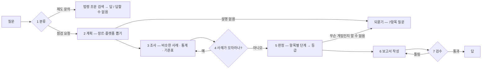

# 발표 준비 노트 — 게임 등급분류 사전 점검 에이전트 (과제 2)

발표자가 **코드를 직접 설명할 수 있도록** 무엇을, 왜, 어떻게 바꿨는지와 수치를 쉬운 말로 정리한 노트다.
발표 자료(PPT)는 이 노트를 보고 직접 만든다. 숫자의 원본은 [`02-measurement.md`](02-measurement.md),
"왜 그렇게 했나"의 원본은 [`decisions/`](decisions/)(결정 기록)에 있다. 이 노트와 원본이 다르면 원본이 맞다.

---

## 0. 30초 요약

- **무엇을 만들었나** — 게임을 출시하기 전에 "몇 세 등급이 나올지"를 미리 점검해 주는 AI 에이전트.
  게임 내용을 설명하면 예상 등급, 그렇게 본 근거, 비슷한 실제 게임, 등급을 낮추려면 무엇을 바꾸면 되는지를 알려 준다.
  등급분류 제도에 대한 질문에는 **법령 조문에 근거해서만** 답하고, 근거가 없으면 "답할 수 없다"고 한다.
- **왜 이 주제인가** — 게임 산업 전공. 한국에서 게임을 유통하려면 등급분류를 받아야 하는데(게임산업법 제21조),
  기준 문구가 추상적이라("유해한 표현이 없는 게임물") 개발자가 미리 가늠하기 어렵다.
- **어떻게 했나** — 게임물관리위원회가 실제로 내린 결정(2024-01 ~ 2026-06, 1,751건)과 공식 기준표·법령을 근거 자료로 두고,
  AI 는 "항목별로 어느 정도 표현인가"만 판단한다. 최종 등급 계산과 근거 확인은 **코드**가 한다.
- **결과(한 줄)** — 같은 AI 모델이 혼자 답할 때(Before)보다 질문 분류(15 → 29/30)·되묻기·검수(0 → 7/7)·제도 안내(2 → 15/17)는 크게 좋아졌다.
  등급 정확도는 한 문장 설명 14 → 19/40, 상세 설명 24 → 27/39 로 조금 나아졌지만 아직 높지 않고, 짧은 설명에서는
  비슷한 사례 5건의 다수결(22/40)보다도 낮다. 데이터 쏠림을 찾아 고친 과정이 가장 큰 배움이었다 — 5절 ⑨.

---

## 1. 과제 2 진행 계획 — 주제 및 세부 기능 리스트

과제 안내 자료는 진행 계획을 과제 1은 개선/신규 포인트 목록으로, 과제 2는 **주제와 세부 기능 목록**으로 쓰게 하고,
열은 `순번 | 영역 | 무엇을 바꾸나 | 추가 설명`이다(요약: [`00-assignment.md`](00-assignment.md)). 과제 2는 "무엇을 바꾸나" 칸에 **새로 만든 기능**을 적는다.
영역 이름은 자료의 예시(RAG·모듈화·그래프 개선·메모리·평가·데이터 보강)에 MCP·Multi-Agent 를 더해 썼다.
아래는 **실제로 만든 결과에 맞춘 최종판**이다 — Day1 에 등록한 계획([`01-plan.md`](01-plan.md))에 진행하며 더한 것(8~10)과 뺀 것(7)을 반영했다.

**주제**: 게임 등급분류 사전 점검 에이전트 — 출시 전 게임 설명으로 예상 등급(전체이용가·12세·15세·청소년이용불가), 항목별 근거,
비슷한 실제 결정, 등급을 낮추는 방법을 알려 주고, 제도 문의는 법령 조문에 근거해 답한다.

| 순번 | 영역 | 무엇을 바꾸나 | 추가 설명 |
| --- | --- | --- | --- |
| 1 | 데이터 | 게임물관리위원회 Open API 로 실제 등급분류 결과 수집 | 2024-01 ~ 2026-09 결정 3,190건. 사례용(~2026-06)과 평가용(2026-07~09)을 기간으로 나눠 정답이 새지 않게 함 |
| 2 | MCP | 등급분류 전용 MCP 서버 추가 | Tool: 같은 장르·플랫폼의 등급 통계 / Resource: 내용정보 7항목 × 4단계 기준표, 시행규칙 제8조, 사례 DB, 게임산업법 조문 |
| 3 | RAG | 유사 사례 검색 + 항목별 단계 판정 | 비슷한 실제 결정 5건을 임베딩으로 찾고, 기준표로 7항목 단계를 판정. 최종 등급은 코드가 "가장 높은 단계"로 계산 |
| 4 | 평가 | 보고서 검수를 사실 대조로 | 예상 등급·인용 사례·통계 숫자를 코드가 대조하고, 뜻은 LLM-as-judge 가 봄. 틀리면 다시 쓰게 함(최대 3회) |
| 5 | RAG(라우팅) | 질문 분류를 의미 라우터로 | 예시 문장과의 유사도로 "제도 문의 / 점검 요청"을 가르고, 애매할 때만 작은 LLM 에 넘김 |
| 6 | 그래프 개선 | 정보가 모자라면 되묻기 | 게임 설명이 없으면 등급을 찍지 않고 7항목 체크리스트로 질문, 다음 턴의 보충 설명과 이어서 판정 |
| 7 | Multi-Agent | 항목별 심사 서브에이전트 — **검토 후 제외** | 등급은 가장 높은 항목 하나로 정해져 나눠 심사해도 이득이 없고, 과대평가 위험·지연(약 7배로 추정)이 커짐 |
| 8 | RAG(추가) | 법령 근거 제도 안내 | 게임산업법·시행령·시행규칙 148개 조문에서만 답하고, 인용 조문·숫자를 코드와 LLM 이 검사해 근거가 없으면 "답할 수 없음" |
| 9 | 데이터 보강(추가) | 사례 DB 쏠림 바로잡기 | 개요 없는 간소화 등급분류(제21조의10, 청불 제외) 결정이 빠져 모바일 사례의 77%가 청불이던 것을 35%로 바로잡음 |
| 10 | 그래프 개선(추가) | 사례 등급과 기준표 판정의 결합 규칙 | 후보 5개를 결과를 보기 전에 정하고 개발용 문항으로 선택(사례 등급을 하한으로) |
| 공통 | 모듈화·테스트 | 새 도메인을 별도 패키지로, 의존성 주입·스위치·단위 테스트 | 스위치를 모두 끈 "LLM 단독"을 Before 로 같은 입력에서 비교, LangSmith 로 노드별 추적, 테스트 114개 |

<details><summary>Google Spread 한 셀에 넣는 짧은 판</summary>

```text
1. [데이터] 게임물관리위원회 API로 실제 등급분류 결과 수집(사례용·평가용 기간 분리)
2. [MCP] 등급분류 MCP 서버 — 등급 통계 Tool, 기준표·법령·사례 Resource
3. [RAG] 유사 사례 검색 + 7개 항목 단계 판정, 최종 등급은 코드가 계산
4. [평가] 검수 강화 — 등급·인용 사례·통계 수치를 데이터와 대조 + LLM 판정
5. [RAG] 의미 라우터로 질문 분류(제도 문의 / 점검 요청)
6. [그래프] 정보 부족 시 되묻기
7. [Multi-Agent] 항목별 심사 — 검토 후 제외(최댓값 규칙이라 이득 없음)
8. [RAG·추가] 법령 근거 제도 안내 — 근거 없으면 "답할 수 없음"
9. [데이터·추가] 간소화 등급분류 결정을 넣어 사례 쏠림 바로잡기
※ Before/After: LLM 단독 vs 에이전트 — 실제 게임 등급 정확도·분류·검수·제도 안내 비교
```

</details>

---

## 2. 먼저 알아 둘 말 (쉬운 풀이)

| 말 | 쉬운 뜻 | 이 프로젝트에서 |
| --- | --- | --- |
| LLM | 글을 읽고 쓰는 AI 모델 | 내 컴퓨터에서 도는 qwen3 — 작은 것(0.6b)은 분류·잡담, 큰 것(8b)은 판정·보고서·검수·법령 답변 |
| 에이전트 | LLM 에게 도구와 절차를 붙여 일을 단계별로 시키는 프로그램 | 분류 → 조사 → 판정 → 작성 → 검수 순서로 일한다 |
| 그래프(LangGraph) · 노드 | 일의 순서도와 그 칸 하나하나 | Base 와 같은 칸 이름(route, plan, research, …)을 그대로 썼다 |
| MCP | 에이전트가 외부 도구·자료를 꺼내 쓰는 표준 규격 | 등급 통계는 Tool(조회 기능), 기준표·법령·사례는 Resource(읽는 자료) |
| RAG | 답하기 전에 관련 자료를 찾아서 그 자료를 보고 답하게 하는 방식 | 비슷한 실제 결정 찾기, 법령 조문 찾기 |
| 임베딩 | 문장을 숫자 묶음으로 바꿔 "뜻이 얼마나 비슷한지" 계산하게 하는 것 | 게임 설명 ↔ 사례 개요, 질문 ↔ 조문, 질문 ↔ 분류 예시 |
| 내용정보 7항목 · 4단계 | 위원회가 보는 표현 항목(폭력성·선정성·공포·언어·약물·범죄·사행성)과 그 수위 | 단계 0~3 이 곧 전체·12·15·청불 |
| 간소화 등급분류 | 신청자가 온라인 시스템에 게임 내용과 등급을 직접 입력하는 간단한 절차(게임산업법 제21조의10). 청소년이용불가 게임은 이 절차를 쓸 수 없다 | 개요가 기록되지 않아 처음에 실수로 빠뜨렸다(5절 ⑨) |
| Before / After | 개선 전 / 후 | Before = 같은 LLM 이 도구 없이 혼자 답함, After = 에이전트 |
| 스위치 | 기능을 켜고 끄는 설정값 | 모두 끄면 Before 가 된다 — 같은 프로그램으로 전후를 잰다 |
| 평가셋 · 개발용 문항 | 정답이 붙은 시험 문제 · 규칙을 고를 때만 쓰는 연습 문제 | 시험 문제(평가셋)를 보고 규칙을 고치지 않으려고 둘을 나눴다 |
| 의존성 주입 | 부품을 밖에서 끼워 넣는 구조 | 부품을 빼면 그 단계는 LLM 단독(기본 동작)으로 돈다 — 그래서 스위치로 Before/After 를 만들 수 있다 |
| 단위 테스트 | 기능이 약속대로 도는지 자동으로 확인하는 작은 시험 | 114개, 진짜 AI 없이(fake) 돌아간다 |
| LangSmith | AI 가 어떤 단계에서 무엇을 했는지 기록해 보여 주는 도구 | 노드마다 추적 기록이 남는다 |

---

## 3. 에이전트가 일하는 순서

예: **"좀비를 총으로 쏘면 피가 튀는 PC FPS예요. 몇 세 등급일까요?"**



1. **분류** — 제도 질문인지 점검 요청인지 가른다. 미리 써 둔 예시 문장 30개와 뜻이 얼마나 비슷한지로 정하고, 애매할 때만 작은 LLM 에 묻는다.
2. **계획** — 질문에서 장르(FPS/TPS)와 플랫폼(PC/온라인)을 코드로 뽑는다. 설명이 아예 없으면("등급 예상해 줘") 여기서 바로 되묻는다.
3. **조사** — (a) 비슷한 실제 결정 5건을 찾고, (b) 같은 장르·플랫폼의 등급 통계를 MCP Tool 로 받고, (c) 기준표를 MCP Resource 로 받는다.
4. **재조사** — 비슷한 사례가 3건보다 적으면 범위를 넓혀(장르+플랫폼 → 플랫폼 → 전체) 다시 찾는다.
5. **판정** — 큰 LLM 이 7항목마다 "있다/없다, 몇 단계, 근거"를 낸다. 근거는 **설명 속 구절**이나 **검색된 사례**만 인정하고,
   코드가 확인해 아니면 지운다. 등급은 **코드가** "가장 높은 단계"로 계산하고, 결합 규칙에 따라 가장 비슷한 사례의 등급을 하한으로 쓴다
   (하한: 그 사례 등급보다 낮게는 보지 않는다). 판정 AI 가 "무슨 게임인지 알 수 없다"고 하면 등급 대신 되묻는다.
   (예: 폭력성 "사실적인 폭력 표현"=15세 → 예상 15세이용가)
6. **보고서** — "예상 등급 / 항목별 판단 / 비슷한 실제 사례 / 같은 장르·플랫폼 통계 / 등급을 낮추려면" 형식으로 쓴다.
   "등급을 낮추려면"은 기준표의 한 단계 아래 표현을 코드가 계산해 준다.
7. **검수** — 보고서의 예상 등급이 계산과 같은지, 인용한 사례와 그 등급이 진짜인지, 숫자가 통계에 있는지를 코드가 먼저 보고,
   마지막에 LLM 이 "질문한 그 게임 이야기인가, 근거와 맞는가"를 본다. 틀리면 이유를 붙여 다시 쓰게 한다.

---

## 4. 코드에서 무엇을 바꿨나 — 파일 지도

과제 1(Base 개선)을 끝낸 뒤 주제를 바꿨다. **Base 의 뼈대는 그대로 두고 새 도메인을 옆에 붙였다**(결정 0009) —
`AGENT_DOMAIN=incident`로 띄우면 원래 인시던트 에이전트가 그대로 돈다. 과제 1 문서는 `docs/task1/`과 git 태그 `task1`에 남겼다.

### 새로 만든 것

| 파일 | 하는 일 | 왜 이렇게 |
| --- | --- | --- |
| `project/agent/rating/graph.py` | 등급 점검 순서도(3절) | Base 와 같은 칸 이름·이벤트를 써서 화면·측정 도구를 그대로 쓴다 |
| `project/agent/rating/llm.py` | 분류·판정·작성·검수·법령 답변용 지시문(프롬프트) | 모델 연결 코드는 Base 것을 다시 쓰고, 지시문만 이 도메인 것으로 |
| `project/agent/rating/assess.py` | 근거 검사, 등급 = 가장 높은 단계, 결합 규칙 | 등급 계산을 AI 에 맡기지 않으려고(등급과 근거가 어긋나지 않게) |
| `project/agent/rating/cases.py` | 비슷한 실제 결정 찾기(임베딩) | 위원회가 실제로 어떻게 결정했는지가 가장 강한 단서였다 |
| `project/agent/rating/check.py` | 보고서 검수 | 등급·사례·숫자처럼 코드로 확인할 수 있는 건 코드가 확인 |
| `project/agent/rating/law.py` | 법령 근거 제도 안내 | 근거 없는 답("청불은 14세 이상")을 막으려고 |
| `project/agent/rating/clarify.py` · `profile.py` | 되묻기 규칙, 장르·플랫폼 뽑기, 되묻기 다음 턴 이어 붙이기 | 설명 없이 등급을 찍지 않게 |
| `project/agent/rating/data.py` · `facts.py` | 등급·항목 이름, 사례 DB 규칙, 통계 / 사실을 글로 적기 | 수집 도구·서버·에이전트·테스트가 같은 정의를 쓰게 |
| `project/mcp_server_rating.py` | MCP 서버 — 통계 Tool, 기준표·법령·사례 Resource | Base 의 MCP 서버와 같은 방식(별도 프로세스) |
| `project/data/ratings/` | 원자료(`raw/`), 사례 DB, 기준표, 시행규칙 제8조, 법령 조문, 분류 예시 | 실행 중에는 기관 API 를 부르지 않는다(호출 제한·시연 안정성) |
| `tools/fetch_ratings.py` · `fetch_laws.py` | 등급 결과·법령 원문 수집 | 다시 받아도 같은 결과가 나오게 |
| `tools/make_rating_evalset.py` · `evalsets/rating*.json` | 평가셋 A(한 문장)·B(상세 설명)·개발용·분류·되묻기·검수·제도 문의·평범한 게임 | **기능 코드보다 먼저** 만들었다 |
| `tools/eval_rating.py` · `choose_combination.py` | 채점, 결합 규칙 고르기 | 고르는 도구는 개발용 결과만 받게 막아 두었다 |
| `project/tests/test_rating_*.py` | 단위·스모크 테스트 | 진짜 AI 없이도 경로와 규칙을 확인 |

### 손본 것 (Base·과제 1 코드)

| 파일 | 무엇을 | 왜 |
| --- | --- | --- |
| `project/server.py` | `AGENT_DOMAIN` 분기, 등급 부품 조립, 스위치 | 같은 서버로 두 도메인·전후 비교 |
| `project/agent/deps.py` | 부품 칸 추가(case_retriever·assessor·clarifier·law_answerer) | 의존성 주입 — 칸이 비면 기본 동작 |
| `project/agent/mcp_client.py` | `find_tool` 추가, 등급 서버 목록 | 어느 서버에 도구가 있는지 미리 가정하지 않고 찾는다(Base 방식) |
| `project/agent/router.py` | 라벨 이름을 고정값에서 인자로 | 과제 1 의미 라우터를 이 도메인에 다시 쓰려고 |
| `scripts/measure-at`, `tools/measure_queries.py` | 등급 평가 단계·스위치 기록 | 같은 커밋에서 Before/After 를 재는 도구 |
| `project/web_chat.html` | `/health` 의 `domain` 을 보고 제목·입력 예시·진행 표시를 등급 점검 문구로 | 원본 문구("운영 인시던트", "장애유형: undefined")가 시연에 그대로 보였다. 인시던트 모드 화면은 그대로 |

### 과제 2에서 손대지 않은 것

`web_demo_server.py`(화면 서버·프록시), `mcp_server.py`·`mcp_server_docs.py`(인시던트), `sh/` 실행 스크립트 — `git diff task1..HEAD`로 확인했다.
채팅 화면(`web_chat.html`)은 노드·이벤트 이름을 과제 1과 같게 둬서 그대로 돌았고, 마지막에 문구만 등급 점검용으로 바꿨다(위 표).

---

## 5. 기능별로 — 무엇을, 왜, 결과, 한계

### ① 데이터 — 실제 결정을 정답으로 (결정 0010)
- **무엇**: 게임물관리위원회 Open API(인증키 없이 공개)에서 2024-01 ~ 2026-09 결정 3,190건을 받았다.
- **왜**: "정답"이 있어야 잘했는지 잴 수 있다. 무작위로 나누지 않고 **기간으로** 나눴다 — 사례는 6월까지, 평가는 7~9월.
  같은 시기 같은 회사의 비슷한 게임이 양쪽에 들어가면 답이 새기 때문이다.
- **뺀 것**: 사행성 게임물(아케이드, 베팅성 보드게임) — 별도 규제이고, 베팅성 보드게임은 328건 중 327건이 청불이라 장르만 봐도 맞힌다.
- **한계**: 평가 입력(개요)이 한 문장(중앙값 43자)이라 원래 맞히기 어렵다. 평가 문항 40개 중 29개는 같은 회사 게임이 사례에 있다.

### ② 평가셋을 먼저 만든 이유
기능을 만든 뒤에 평가 문제를 만들면, 결과를 보며 문제나 정답을 고르게 되기 쉽다. 그래서 **기능 코드보다 먼저** 만들고, 결과를 본 뒤에는 고치지 않았다.
예외 한 번 — 제도 문의 평가의 채점 규칙이 의도보다 좁아(나이 14·18·19·20만 금지) "15세 이상" 오답을 통과시켜서 의도대로 넓혔고, 그 사실을 기록했다.

### ③ 유사 사례 검색 + 항목별 단계 판정 (결정 0011)
- **무엇**: 비슷한 실제 결정 5건을 찾고, 기준표로 7항목 단계를 판정한다. 등급은 코드가 "가장 높은 단계"로 계산한다.
- **왜**: AI 에게 등급을 바로 묻자(Before) 등급과 내용정보가 서로 맞지 않았다 — "전체이용가"라고 하면서 7개 항목을 다 붙였다.
- **알게 된 것**: 사례 검색을 끄고 기준표만 쓰면 한 문장 설명에서 **8/40** — Before(14/40)보다도 낮다. 짧은 설명엔 판정 근거가 없어서다.
  반대로 상세 설명(평가셋 B)에서는 기준표만 쓴 판정이 가장 높았다(28/39). **두 부품이 서로 다른 입력에서 강하다.**

### ④ 보고서 검수 (결정 0012)
- **무엇**: 형식 → 등급 일치 → 사례 대조 → 숫자 대조(코드) → 질문과 맞는지·근거와 맞는지(LLM).
- **결과**: 일부러 오염시킨 보고서 7개를 0개 → **7개** 잡았고, 정상 보고서 5개는 하나도 막지 않았다.
- **에피소드**: 처음 실제로 돌렸을 때 보고서 6개 중 3개가 경고를 달고 나갔다. AI 가 사례 번호(예: `CC-OM-250109-001`)와 사례 개요의 숫자("같은 모양의 블럭 3개를 연결해")를
  옮겨 써서 숫자 검사에 걸린 것. 사례 번호를 숨기고 사례 개요의 숫자는 근거로 인정하게 고친 뒤 0개가 됐다 — **검사 규칙은 실제 답을 보고 다듬어야 한다**는 교훈.

### ⑤ 의미 라우터 · ⑥ 되묻기 (결정 0013)
- Before 의 작은 LLM(0.6b)은 점검 요청 15개를 **전부** 일반 대화로 보냈다(15/30). 과제 1 에서 만든 의미 라우터를 예시 문장만 바꿔 다시 쓰자 **29/30**.
- 되묻기: 설명이 아예 짧으면 바로, 길어도 내용이 없으면 판정 AI 가 "무엇을 하는 게임인지 알 수 없다"고 할 때 되묻는다 — 6/12 → **10/12**.
- "애매하다"의 기준(두 분류와의 비슷한 정도 차이가 0.04 미만이면 작은 LLM 에 넘김)은 평가셋이 아니라 **예시 문장**으로 정했다.

### ⑦ 멀티에이전트를 뺀 이유 (결정 0009)
등급은 가장 높은 항목 하나로 정해진다. 7항목을 따로 심사해도 최종 등급에 더해지는 정보가 없고, 판정을 7번 따로 하면 그중 하나라도
높게 볼 확률이 커져 과대평가가 는다. 내 컴퓨터의 AI 는 요청을 하나씩 처리해 판정 시간도 약 7배로 늘어난다(계산으로 본 추정 — 만들어 재지는 않았다).
정답 데이터에는 항목별 단계가 없어 효과를 잴 수도 없다.

### ⑧ 법령 근거 제도 안내 (결정 0015 — 발표자 제안으로 추가)
- **왜**: Before 는 "청소년이용불가는 14세 이상", "수수료는 1000원", "리그 오브 레전드는 4세 등급"을 지어냈다.
- **무엇**: 게임산업법·시행령·시행규칙 148개 조문(국가법령정보센터 원문)에서 관련 조문 4개를 찾아 그것만 보고 답한다.
  인용한 조문이 진짜 찾은 조문인지, 답의 숫자가 그 조문에 있는지 코드가 확인하고, 마지막에 LLM 이 조문 원문과 대조한다. 하나라도 어기면 "답할 수 없습니다".
- **결과**: 제도 문의 17개 중 2개 → **15개**. 법령에 없는 질문(전화번호, 신청 건수, 특정 게임 등급)은 3개 모두 "답할 수 없음".
- **솔직하게**: "청소년이용불가는 몇 살부터?"에 "15세 이상"이라고 답한 경우가 남았다. 게임산업법은 청소년 나이를 「청소년 보호법」에 맡기는데,
  AI 가 시행규칙의 15세이용가 기준 숫자를 갖다 붙였다. 숫자가 조문에 있어서 코드 검사를 지나갔고, LLM 대조 검수도 놓쳤다.
  회귀 쿼리의 비슷한 질문("청소년이용불가 등급은 몇 살부터 이용할 수 있나요?")은 LLM 대조 검수가 막았다 — 검수가 이 실수를 늘 잡지는 못한다.

### ⑨ 데이터 쏠림 찾아 고치기 (결정 0017 — 발표에서 가장 이야기할 거리)
- **증상**: 사례 등급을 반영하는 규칙(⑩)을 넣자 "귀여운 고양이 블록 퍼즐"이 **청소년이용불가**로 나왔다.
- **처음 짐작**: "모바일 게임은 대부분 구글·애플이 자체등급분류를 하니까 위원회 데이터엔 청불만 남는다" — 확인 없이 문서에 적었다가 틀렸다.
- **원인(데이터로 확인)**: 사례 DB 를 만들 때 "개요가 있는 결정만" 남겼는데, 개요가 없는 결정의 대부분은 **간소화 등급분류**였다.
  게임산업법 제21조의10은 이 절차에서 **청소년이용불가를 제외**한다. 그래서 필터가 낮은 등급의 모바일 게임만 골라 지웠다.

  | 사례 기간 모바일 결정 | 실제 | 필터 뒤 남은 것 |
  | --- | ---: | ---: |
  | 전체이용가 | 293 (53%) | 34 |
  | 청소년이용불가 | 188 (34%) | 181 |

- **고침**: 개요 없는 결정도 사례 DB 에 넣었다(1,396 → 1,751건). 모바일 사례의 청불 비율 **77% → 35%**.
- **고친 효과**: 귀여운 고양이 퍼즐은 전체이용가로 돌아왔다 — 가장 비슷한 사례가 「고양이와 블록」(전체이용가)이고, 통계도 "퍼즐 · 모바일 133건 중 전체이용가 99건"으로 바뀌었다.
  다만 피가 나오지 않는 좀비 게임은 여전히 청불이다. 이건 데이터 쏠림이 아니라 결합 규칙(⑩)의 성질이다.
- **고친 뒤 생긴 약점**: 평가셋 A 정확도는 22 → 19/40 으로 내려갔다. 바뀐 3문항 모두 새로 넣은 "개요 없는 결정"이 가장 비슷한 사례로 뽑혔다.
  예를 들어 뱀파이어가 농장을 꾸리는 시뮬레이션(정답 12세)에 「마이드림키친」(시뮬레이션·모바일, 전체이용가)이 뽑혀 12세로 올리지 못했다.
  개요가 없으니 **제목·장르·플랫폼만 보고** 비슷하다고 본 것이다. 다음 개선: 등급을 끌어올리는 근거에는 개요가 있는 사례만 쓰고, 개요 없는 사례는 통계에만 쓴다.
- **교훈**: 필터 하나가 "데이터의 모양"을 바꾼다. 수치가 이상하면 짐작하지 말고 원자료와 법령으로 확인한다. 그리고 고친 것이 또 다른 약점을 만들 수 있어 고친 뒤에도 다시 잰다.

### ⑩ 사례 등급과 기준표의 결합 규칙 (결정 0016)
- **무엇**: 후보 5개 — R0 지금 방식(항목 단계의 최댓값) / R1 가장 비슷한 사례의 등급을 하한으로 / R2 설명이 얇으면 가장 비슷한 사례 1건 /
  R3 얇으면 사례 5건 다수결 / R4 얇으면 하한 — 를 **결과를 보기 전에** 문서에 적어 커밋하고(`39166d0`), 평가셋과 겹치지 않는 **개발용 문항 38개**로 골랐다.
  고르는 기준도 미리 정했다(정확도 최고 → 동률이면 과소평가가 적은 것 → 그래도 같으면 단순한 것).
- **고른 것**: R1 — 개발용 38문항에서 18개(R0 14개). 사례 DB 를 고친 뒤 같은 방법으로 다시 골라도 R1(18개, R0 13개).
- **대가**: 실제보다 낮게 보는 실수(과소평가)는 줄었지만 높게 보는 실수(과대평가)가 늘었다 — 개발용 문항에서 과소 21 → 11건, 과대 2 → 8건.
  평범한 게임 10개에서는 LLM 단독(9개 맞힘, 청불 0)이 에이전트(8개, 청불 1 — 요리 경영 게임)보다 나았다. 가장 비슷한 사례가 선정성 때문에 청불인 선술집 경영 게임이었다.
- **결정**: R1 을 기본값으로 유지한다(2026-10-21). 미리 정한 기준대로 고른 결과이고, 더 위험한 과소평가를 줄이기 때문이다(8절 "과소평가가 더 위험한 이유").
  고른 뒤에 본 과대평가 사례로 규칙을 바꾸지 않고 한계로 밝힌다 — 바꾸면 "결과를 보고 맞췄다"가 된다.

---

## 6. Before/After 수치

**재는 방법** — 같은 프로그램, 같은 커밋에서 **스위치만 바꿔** 쟀다. Before = 스위치를 모두 끈 상태 = 같은 LLM 이 기준표·사례·검수 없이 혼자 답함
(등급 판정은 qwen3:8b, 질문 분류·제도 문의는 qwen3:0.6b — Before 와 After 가 같은 모델을 쓴다). 모든 측정은 내 컴퓨터의 Ollama 로 했고, 원자료는 `runs/`에 있다.
After 는 최종 상태(사례 DB 수정 뒤, `133901f`) 값이다. Before 는 사례 검색을 쓰지 않아 사례 DB 수정과 상관없다.

| 지표 | Before (LLM 단독) | After (최종) | 비고 |
| --- | ---: | ---: | --- |
| 등급 정확도 — 평가셋 A, 한 문장 설명 (40) | 14 | **19** | 사례 DB 수정 전 22 → 수정 뒤 19 (5절 ⑨) |
| 등급 정확도 — 평가셋 B, 상세 설명 (39) | 24 | **27** | 수정 전후 같음 |
| 과소평가 · 과대평가 — 평가셋 A | 25 · 1 | 15 · 6 | 과소평가(출시 뒤 등급 상향)가 줄고 과대평가가 늘었다 |
| 과소평가 · 과대평가 — 평가셋 B | 11 · 4 | 2 · 10 | 〃 |
| 평범한 게임 10개 — 전체이용가로 맞힘 · 청소년이용불가로 봄 | **9 · 0** | 8 · 1 | LLM 단독이 더 나았다. 정답은 문항을 쓴 사람이 붙였다 |
| 질문 분류 (30) | 15 | **29** | Before 는 점검 요청을 모두 일반 대화로 보냈다 |
| 되묻기 (12) | 6 | **10** | |
| 오염 보고서 탐지 (7) · 정상 보고서 오탐 (5) | 0 · 0 | **7 · 0** | |
| 제도 문의 (17) | 2 | **15** | |
| 회귀 쿼리 — 점검 경로를 탄 턴 (8) | 0 | **8** | Before 는 모두 일반 대화로 답했다 |

**기준선** — "LLM 단독보다 낫다"만으로는 부족해서, LLM 없이 비슷한 사례의 등급만 보는 단순한 방법과도 비교했다.

| 방법 | 평가셋 A (40, 한 문장) | 평가셋 B (39, 상세) |
| --- | ---: | ---: |
| 무작위로 찍기 (기대값) | 10 | 9.8 |
| 늘 가장 흔한 등급 | 10 | 19 (늘 청불) |
| 가장 비슷한 사례 1건의 등급 | 20 | 23 |
| 비슷한 사례 5건 다수결 | **22** | 23 |
| 기준표만 쓴 판정 (사례 검색 끔) | 8 | **28** |
| 에이전트 (최종) | 19 | 27 |

- 한 문장 설명(A)에서는 **사례 5건 다수결(22)이 에이전트(19)보다 높다.** 짧은 설명엔 판정할 표현이 없어 과거의 비슷한 결정이 가장 강한 단서다.
- 상세 설명(B)에서는 **기준표만 쓴 판정(28)이 가장 높다.** 에이전트(27)는 사례 등급을 하한으로 써서 12·15세를 청불로 올린 문항이 있다.
- 정직한 결론: 설명이 짧으면 사례, 길면 기준표가 강하다. 지금 결합 방식은 어느 쪽에서도 최선은 아니다.

**더 강한 모델로 재 본 보조 표** — OpenAI(gpt-4o-mini·gpt-4o), 같은 평가셋, 한 번 측정. 위 qwen 표를 대신하지 않는다([`02-measurement.md`](02-measurement.md) "보조 측정" 절).

| 지표 | OpenAI 단독 → 에이전트 | 상승폭 (qwen 상승폭) |
| --- | ---: | ---: |
| 등급 정확도 A (40, 한 문장) | 18 → 20 | +2 (+5) |
| 등급 정확도 B (39, 상세) | 25 → 31 | +6 (+3) |
| 질문 분류 (30) | 30 → 29 | −1 (+14) |
| 제도 문의 (17) | 3 → 16 | +13 (+13) |
| 평범한 게임 전체이용가 (10) | 10 → 6 | −4 (−1) |

- 걱정한 대로 모델이 좋아지면 줄어드는 이득(분류, 짧은 설명)이 있고, 남거나 커지는 이득(제도 문의, 상세 설명)이 있다.
- Before 의 제도 문의 채점은 형식에 엄격하다(조문 번호를 안 적으면 0점). 프롬프트는 qwen 기준이라 OpenAI 에 맞추면 달라질 수 있다.

**속도와 비용**
- 판정 한 번: Before 4.7초 → After 16.0초(평가셋 A 중앙값). 상세 설명(B)은 3.5초 → 17.3초.
- 회귀 쿼리 한 턴 왕복 중앙값: Before 2.4초 → After 37.3초. 점검 답변은 37~63초 — 판정·보고서 작성·검수를 모두 하기 때문이다.
- 비용(가상 단가): 평가셋 A 40문항에 $0.065 → $0.303. 내 컴퓨터에서 돌아 실제 과금은 없다.

---

## 7. 한계와 트레이드오프 (평가 20점 — 스스로 짚을 것)

| 한계 | 왜 생겼나 | 어떻게 하면 나아질까 |
| --- | --- | --- |
| 등급 정확도가 아직 높지 않다 — 짧은 설명에서는 사례 5건 다수결(22/40)보다도 낮다 | 평가 입력이 한 문장 개요라 등급을 가른 표현이 없다. 판정은 그 표현을 찾고, 없으면 낮게 본다 | 실제 사용은 상세 설명(평가셋 B 27/39). 설명이 짧으면 되묻기를 더 적극적으로 |
| 과대평가 ↔ 과소평가 맞바꿈 | 사례 등급을 하한으로 쓰면 낮게 보는 실수는 줄지만 비슷한 성인 게임 하나에 끌려 올라간다(평가셋 B 과대평가 4 → 10, 평범한 게임은 LLM 단독보다 1개 더 틀림) | 사례를 등급 분포로 쓰거나(다수결), 그 사례의 내용정보가 설명과 겹칠 때만 하한으로 |
| 개요 없는 사례가 "가장 비슷한 사례"로 뽑힌다 | 쏠림을 고치려고 개요 없는 결정을 넣었더니 제목·장르·플랫폼만 비슷한 사례의 등급을 따르는 경우가 생겼다(평가셋 A 22 → 19) | 등급을 끌어올리는 근거에는 개요 있는 사례만 쓰고, 개요 없는 사례는 통계에만 |
| 데이터는 위원회 결정뿐 | 오픈마켓 자체등급분류 게임은 API 에 없다 | 「자체등급분류 게임물 연계 정보」 데이터 확인 |
| 기준표의 "단계 = 등급"은 요약 | 실제 위원회는 주제·맥락까지 본다 | 결정서 사유 텍스트를 RAG 로 |
| 사례 등급을 따른 이유 설명이 부정확하다 | 보고서의 사실 문장이 늘 "설명이 부족해 사례 등급을 따랐다"고 쓴다. R1 은 설명이 충분해도 사례 등급을 하한으로 쓴다 | 문장을 "가장 비슷한 사례의 등급을 하한으로 썼다"로 고치고 검수에 넣기 |
| 강한 모델에서 되묻기가 과하다 | 되묻기 조건을 qwen 기준으로 정했는데, gpt-4o 는 평범한 리듬·축구 게임 설명에도 "무슨 게임인지 알 수 없다"고 했다(평범한 게임 6/10) | 모델을 바꾸면 되묻기 조건을 개발용 문항으로 다시 맞춘다 |
| 법령 답변이 해석을 틀릴 수 있다 | 숫자가 조문에 있어도 다른 항목의 숫자일 수 있다("15세") | 검수 지시문 보강, 질문 대상과 조문 항목을 맞추는 규칙 |
| 덜 친절하다 | 법령에 없는 실무 정보(수수료 금액, 기간, 연락처)는 답하지 않는다 | 위원회 공지·고시를 근거 자료로 추가 |
| 느리다 | 큰 LLM 을 판정·작성·검수에 세 번 이상 부른다 | 판정과 작성을 합치거나 작은 모델 — 과제 1에서 작은 모델은 품질 미달(결정 0008) |
| 평가셋을 여러 번 봤다 | R1 확인 뒤 데이터를 고쳐 A·B 를 두 번째로 쟀다 | 규칙 선택은 늘 개발용 문항으로만 했다. 다음엔 새 평가 기간(10월 결정)으로 확인 |
| 문항 수가 적다 | 40·39·38개 — 2~4문항 차이는 우연일 수 있다 | 기간을 늘려 문항을 더 모은다 |
| 짐작을 사실처럼 적은 적이 있다 | 쏠림 원인을 확인 전에 "자체등급분류 때문"이라 적었다 | 확인 못 한 것은 followups 에, 확인한 뒤에만 결정 기록에 |

---

## 8. 발표 흐름 제안 (평가 기준 순서: 문제 → 개선/추가 포인트 → 수치 → 한계·추가 개선)

마감: Day3 **13시**까지 Git 주소·결과 보고서 주소를 Google Spread 에 등록한다(2026-10-20 공지로 14시에서 당겨짐). 발표는 Day3 17:30까지 반별로 한다.

| 순서 | 말할 것 | 보여 줄 것 |
| --- | --- | --- |
| 1. 문제 (1분) | 게임은 출시 전 등급분류가 필수인데 기준이 추상적이다. LLM 에게 그냥 물으면 지어낸다("청불은 14세", "수수료 1000원") | Before 답변 캡처 |
| 2. 만든 것 (2분) | 3절 순서도. 핵심은 "AI 는 항목만 판단, 등급 계산과 근거 확인은 코드" | 순서도 1장 |
| 3. 기능 (3분) | ③ 사례+기준표, ④ 검수, ⑤⑥ 분류·되묻기, ⑧ 법령 근거 | 시연 또는 캡처 |
| 4. 수치 (2분) | 6절 표 — 같은 커밋에서 스위치만 바꿔 쟀다는 점 강조. 과소평가가 줄고 과대평가가 는 것을 "일부러 택한 방향"으로 설명(아래) | 표 1장 + 기준선 |
| 5. 발견 (2분) | ⑨ 데이터 쏠림 — 증상 → 틀린 짐작 → 데이터·법령으로 원인 확인 → 수정 | 모바일 표 |
| 6. 한계·다음 (1분) | 7절에서 3~4개 | 표 |

### 과소평가가 더 위험한 이유 — 수치·한계 장표에서 말할 것

> 슬라이드 한 줄: **과소평가는 출시 직전에 계획을 뒤집고, 과대평가는 미리 조심하게 만든다. 그래서 과소평가를 줄이는 쪽을 택했다.**

| | 과소평가 (실제보다 낮게 예상) | 과대평가 (실제보다 높게 예상) |
| --- | --- | --- |
| 예 | "12세면 되겠다" → 심의에서 15세·청불 | "청불이겠다" → 심의에서 12세 |
| 개발자에게 생기는 일 | 정해 둔 대상 연령·출시 일정·마케팅을 다시 짜거나, 내용을 고쳐 다시 심의를 받아야 할 수 있다. 늦게 알수록 비싸다 | 표현을 미리 줄이거나 보수적으로 준비한다. 쓸데없는 수정 비용은 있지만 심의에서 낮게 나오면 손해가 작다 |
| 우리 지표 | 처음부터 "가장 위험한 오류"로 따로 셌다(측정 계획) | "평범한 게임을 청불로 본 수"로 따로 셌다 |

말할 숫자(문항 수와 함께):
- 과소평가 — LLM 단독 → 에이전트: 평가셋 A 25 → 15건(40개 중), 평가셋 B 11 → 2건(39개 중). 결합 규칙만 비교하면 개발용 문항에서 R0 22 → R1 11건(38개 중).
- 대가인 과대평가 — 평가셋 B 4 → 10건, 평범한 게임 10개 중 1개를 청불로 봤다(LLM 단독 0개).
- 그래서 보고서는 사례 등급을 따랐을 때 그 사실을 밝히게 했고(작성 모델이 빠뜨린 경우 1건 — 7절), 끝에 "참고용 예측이며 실제 등급은 위원회 심의로 정해진다"를 붙인다.

---

## 9. 시연 순서

```bash
cd project
bash sh/run_agent_ollma.sh
```

```bash
cd project
bash sh/run_frontend.sh
```

브라우저에서 <http://localhost:8600>. 실행 스크립트는 기동할 때 8100·8600 포트의 프로세스를 끄고 `session.db`를 지운다.

**OpenAI 로 시연할 때** — 한 턴 1~7초로 빠르지만 요청마다 과금된다([결정 0018](decisions/0018-openai-backend-for-rating-demo.md)).
사례 검색·질문 분류의 임베딩은 로컬이라 Ollama 를 먼저 띄운다. 터미널 세 개에서 차례로:

```bash
ollama serve
```

```bash
cd project && bash sh/run_agent_openai.sh
```

```bash
cd project && bash sh/run_frontend.sh
```

- 백엔드 스크립트가 묻는 "계속하시겠습니까?"에 `y`. 끝에 보여 주는 curl 예시는 과제 1(auth-service) 것이라 무시한다.
- 발표의 수치는 모두 qwen3(Ollama)로 잰 값이다. OpenAI 답은 다를 수 있다(예: 신체 절단 RPG — qwen 15세이용가, gpt-4o 청소년이용불가).
  "같은 에이전트에 모델만 바꿔 끼울 수 있다"까지만 말하고, OpenAI 결과를 수치로 쓰지 않는다.
- 진행 표시가 단계마다 나온다: 등급 점검 요청으로 분류 → 계획 → 비슷한 실제 결정 N건 → 통계(MCP Tool) → 기준표(MCP Resource) → 항목별 판정 → 초안 → 검수. 설명할 때 이 줄을 짚으면 된다.

아래 입력은 모두 평가셋·회귀 쿼리에 있는 문장이라 측정 때(qwen3) 나온 답을 알고 있다. 온도 0으로 돌려 변동은 적지만 같은 답이 보장되지는 않는다 — 리허설로 한 번 확인한다.

| 입력 | 측정 때 나온 답 | 보여 줄 점 |
| --- | --- | --- |
| 게임 등급은 몇 가지로 나뉘고 각각 무슨 뜻이에요? | 4개 등급의 뜻 + "근거: 게임산업법 제21조(등급분류)" (제도 문의 평가 l01) | 답 끝의 근거 조문 목록은 모델이 아니라 코드가 붙인다 |
| 게임물관리위원회 전화번호 알려 주세요 | "답할 수 없습니다" + 찾아본 조문 4개 (제도 문의 평가 f01) | 근거가 없으면 지어내지 않는다 |
| 이번에 출시할 FPS 게임 등급 점검해 주세요 → (다음 메시지) 테러리스트를 총으로 제압하는데 피가 사실적으로 튀고 욕설 대사도 조금 있어요 | 되묻기 → 15세이용가 (회귀 쿼리 9) | 설명 없이 등급을 찍지 않고, 다음 턴의 설명을 이어 붙여 판정한다 |
| 모바일 퍼즐 게임이에요. 귀여운 고양이를 움직여 같은 색 블록을 맞추면 점수를 얻어요. 몇 세 등급일까요? | 전체이용가 — 가장 비슷한 사례 「고양이와 블록」(전체이용가), 통계 "퍼즐 · 모바일 133건 중 전체이용가 99건" (회귀 쿼리 4 — 사례 DB 수정 전에는 청소년이용불가) | 5절 ⑨ 데이터 쏠림 이야기와 함께 |
| PC 액션 RPG인데 검으로 몬스터를 베면 피가 튀고, 보스를 처치하는 장면에서 신체가 절단돼요. 등급 점검해 주세요 | 15세이용가 (회귀 쿼리 5) | 항목별 근거, 비슷한 실제 사례, 등급을 낮추는 방법 |

Before(LLM 단독)를 같은 화면에서 보여 주려면 스위치를 끄고 띄운다(`.env`에 같은 이름이 있으면 `.env` 값이 이긴다).

```bash
ROUTER=llm RATING_CLARIFY=off CASE_SEARCH=off RATING_ASSESSOR=direct VALIDATOR=format CHAT_GROUNDING=off bash sh/run_agent_ollma.sh
```

- 점검 한 번에 40~60초 걸린다. 시연 시간을 고려해 캡처를 미리 떠 두는 것이 안전하다.
- 피가 나오지 않는 좀비 게임(회귀 쿼리 10)은 여전히 청소년이용불가로 나온다. 한계를 보여 줄 때만 쓴다 — 이 답의 "설명만으로는 판정 근거가 부족해" 문장은
  정확하지 않다(설명 인용이 근거로 있었다. followups). 연애 시뮬레이션(회귀 쿼리 6)은 보고서 모양이 흐트러져 나와 시연에 쓰지 않는다.
- 화면을 새로 열 때 예전 문구가 보이면 브라우저 캐시다 — 새로고침(⌘+Shift+R)한다.
- 측정과 시연을 동시에 하지 않는다(같은 Ollama 를 쓰면 느려진다).

---

## 10. 예상 질문과 답

- **과제 1을 하다가 왜 바꿨나?** 과제 1(인시던트 개선 5개)은 끝냈다(`docs/task1/`). 전공을 살린 주제로 Base 구조가 다른 도메인에도 통하는지 보고 싶었다. 과제 1 에서 만든 의미 라우터·검수·측정 도구를 그대로 다시 썼다.
- **새 프로젝트인데 Before 가 무엇인가?** 같은 LLM 이 도구 없이 혼자 답하는 것. 에이전트의 부품을 모두 끈 상태라 같은 프로그램·같은 입력으로 비교할 수 있다.
  (※ 이 방식을 Before/After 로 인정하는지는 강사 확인이 아직이다 — [`followups.md`](followups.md)의 **(직접)** 항목.)
- **정확도가 절반 안팎이면 낮지 않나?** 낮다. 한 문장 설명에서 40개 중 19개(무작위 10개, LLM 단독 14개, 사례 5건 다수결 22개), 상세 설명에서 39개 중 27개(LLM 단독 24개, 기준표만 쓴 판정 28개)다. 그래서 "참고용 사전 점검"이라고 말하고, 근거와 비슷한 실제 사례를 함께 보여 주는 데 무게를 둔다.
- **과대평가와 과소평가 중 무엇이 더 나쁜가?** 과소평가가 더 위험하다고 보고 그쪽을 줄이는 규칙(R1)을 택했다 — 8절 표. 과소평가는 출시 직전에 대상 연령·일정·마케팅을 뒤집고, 과대평가는 미리 조심하게 만든다. 다만 과대평가도 비용이 있어서 "평범한 게임을 청불로 본 수"를 따로 쟀다(10개 중 1개).
- **평가셋을 보고 맞춘 것 아닌가?** 평가셋은 기능보다 먼저 만들었고, 규칙은 개발용 문항으로만 골랐다. 후보와 기준은 결과를 보기 전에 문서에 적고 커밋했다(`39166d0`). 다만 데이터를 고친 뒤 평가셋을 두 번째로 본 것은 한계로 밝힌다.
- **멀티에이전트는?** 검토했지만 뺐다 — 5절 ⑦.
- **더 좋은 모델이면 에이전트가 필요 없지 않나?** 그래서 OpenAI(gpt-4o-mini·gpt-4o)로도 같은 평가셋을 재 봤다(6절 보조 표, 본 수치와 별도).
  질문 분류는 강한 모델 혼자 30/30 이라 이득이 사라졌고, 한 문장 설명 등급도 +5 → +2 로 줄었다. 하지만 제도 문의는 +13 그대로다 —
  강한 모델도 혼자서는 "청소년이용불가는 18세 이상부터", 법령에 없는 전화번호 같은 근거 없는 답을 냈다. 상세 설명 등급은 +3 → +6 으로 오히려 커졌다.
  반대로 평범한 게임은 LLM 단독이 10/10, 에이전트가 6/10 이다(되묻기 2, 사례 하한 2). 정리하면 "모델이 좋아질수록 단순 분류 같은 보조는
  필요 없어지고, 근거를 찾고 검증하는 구조의 가치는 남는다".
- **AI 가 틀리면 어떻게 아나?** 등급은 코드가 계산하고, 근거·사례·숫자는 코드가 대조하고, 뜻은 LLM 검수가 본다. 그래도 놓친 사례(⑧의 "15세")가 있다.
- **데이터는 써도 되나?** 위원회 API 는 공공데이터포털 표기로 이용 제한이 없다. 결정서 사유는 공공누리 1유형(출처 표시). 법령은 저작권 보호 대상이 아니다. 사례집 기준어 28개는 재사용 조건을 확인 중이다.

---

## 11. 발표할 때 피할 표현

- "정확도 OO% 달성" → 문항 수와 함께("40개 중 19개"), 기준선과 함께 말한다.
- "법령에 근거해 틀리지 않는다" → "근거가 없으면 답하지 않도록 했고, 그래도 놓친 경우가 1건 있다".
- "실제 등급을 예측한다" → "참고용 사전 점검 — 실제 등급은 위원회 심의로 정해진다".
- "비용이 OO원 든다" → `cost_usd`는 토큰 수 × 가상 단가의 추정이다. 실제 과금은 없다.

---

## 12. 더 볼 곳

| 궁금한 것 | 문서 |
| --- | --- |
| 계획 원본 | [`01-plan.md`](01-plan.md) |
| 수치 원본·측정 방법 | [`02-measurement.md`](02-measurement.md) |
| 파일·함수 단위 설계와 계획에서 바뀐 것 | [`03-design.md`](03-design.md) |
| 기능마다 왜·한계 | [`decisions/0009`](decisions/0009-rating-domain.md) ~ [`0017`](decisions/0017-simplified-decisions-in-case-db.md) |
| 확인 못 한 것 | [`followups.md`](followups.md) |
| 과제 안내 요약·평가 기준 | [`00-assignment.md`](00-assignment.md) |
